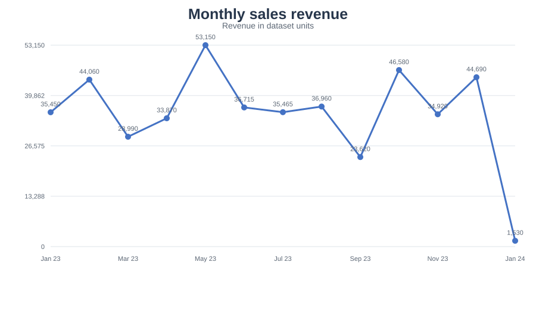
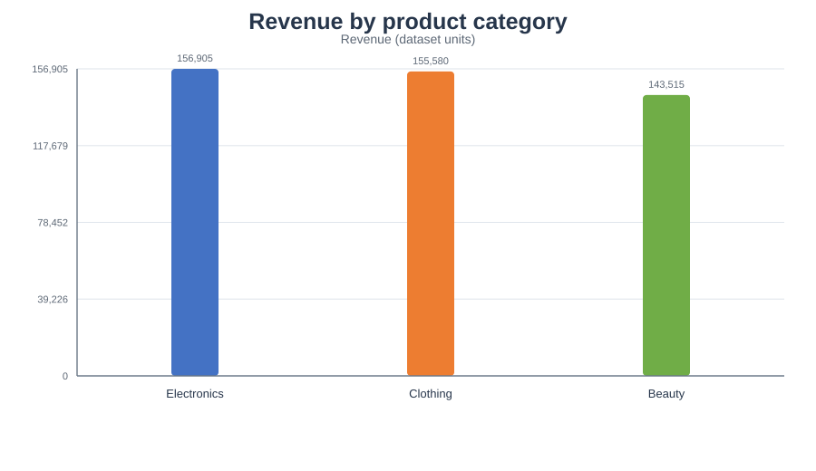
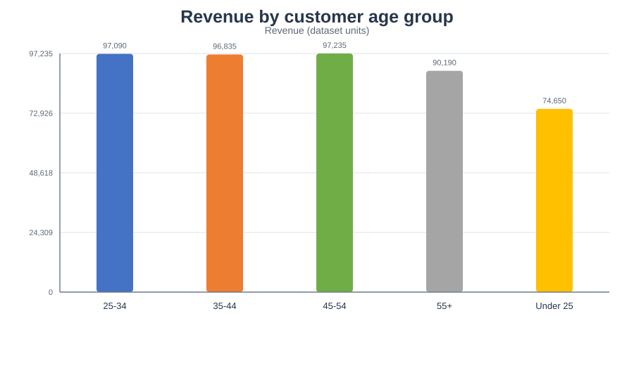
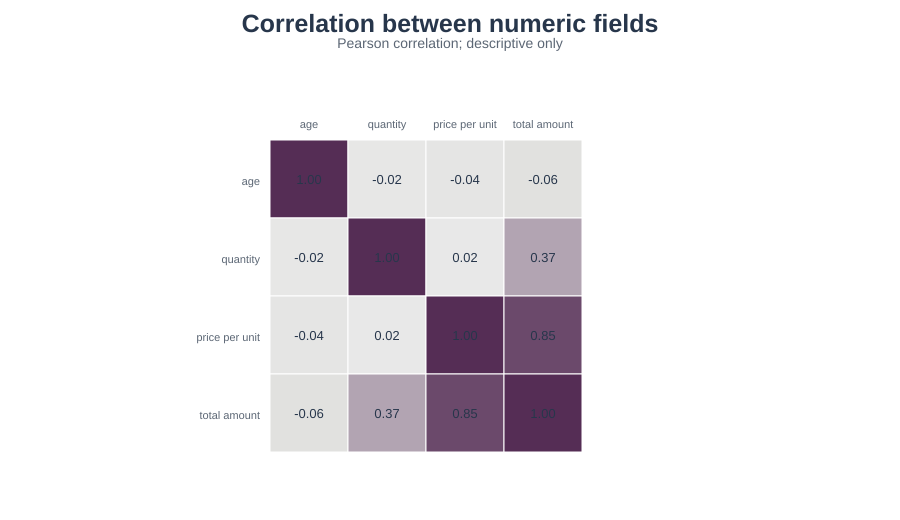

# Retail Sales EDA (OASIS INFOBYTE - Data Analytics Task 1)

A reproducible exploratory analysis of the retail sales sample dataset named in the Task 1 brief. The project uses Python, pandas, NumPy, Matplotlib, Seaborn and a Jupyter notebook to check data quality, describe the sample, study sales over time, compare customer demographics and product categories, and translate observed patterns into cautious recommendations.

The dataset source labels this 1,000-row file as a synthetic sample dataset and lists it as CC0: Public Domain. It is not audited business data. The currency is not specified. Findings must be presented as patterns in this sample, not as facts about a real retailer.

## Project contents

```text
DataAnalytics-L1-EDARetailSales/
├── data/retail_sales_dataset.csv       # Supplied Kaggle sample with attribution below
├── notebooks/EDA_Retail_Sales.ipynb    # Walkthrough, charts and written observations
├── src/retail_eda.py                   # Cleaning, summaries, charts and report helpers
├── scripts/run_analysis.py             # Rebuild chart and report outputs
├── tests/test_retail_analysis.py       # Reproducible quality and behavior checks
├── reports/findings.md                 # Findings and recommended next steps
└── screenshots/                        # Exported plots used in the analysis
```

## Open in VS Code

1. Open the repository folder `OIBSIP-DataAnalytics` in VS Code.
2. Open `DataAnalytics-L1-EDARetailSales/notebooks/EDA_Retail_Sales.ipynb`.
3. Select the Python interpreter at `DataAnalytics-L1-EDARetailSales/.venv/Scripts/python.exe`, or create an environment with the commands below.
4. Run the notebook from the first cell to the last. The notebook writes charts to `screenshots/` and the conclusions to `reports/findings.md`.

```powershell
cd DataAnalytics-L1-EDARetailSales
py -m venv .venv
.\.venv\Scripts\Activate.ps1
python -m pip install -r requirements.txt
python -m pip install jupyter
```

Then launch VS Code's Jupyter notebook support or run `jupyter notebook notebooks/EDA_Retail_Sales.ipynb`.

To rebuild the exported charts and report without opening Jupyter:

```powershell
python scripts/run_analysis.py
```

Run the checks with:

```powershell
python -m unittest discover -s tests -v
```

## Analysis scope

- Inspect dimensions, dtypes, missing values, duplicate rows and duplicate transaction IDs before cleaning.
- Parse dates, standardize categories and demographic labels, preserve unknown demographics, remove duplicate transaction IDs and exclude rows that cannot support sales totals.
- Calculate mean, median, mode and sample standard deviation for numeric fields.
- Compare monthly and quarterly revenue, transaction counts, customer age groups, recorded gender and category sales.
- Plot a correlation heatmap, age distribution, category bars, revenue share, weekday revenue, price/amount scatter and transaction amount outliers.
- Exclude the first and last month from full-month comparisons to avoid treating partial periods as complete.

## Findings and interpretation

The executed numbers and interpretations are in [`reports/findings.md`](reports/findings.md). The project deliberately does not infer an individual product ranking because the source has no product name or SKU field. It also avoids claims about customer lifetime value because the supplied customer IDs do not provide repeat-purchase history. `Total Amount` equals `Quantity x Price per Unit` in this sample, so correlations involving amount and its inputs are partly built into the calculation.

## Dataset source and attribution

The CSV is the 1,000-row Retail Sales Dataset attributed to `mohammadtalib786` on Kaggle: [Kaggle dataset page](https://www.kaggle.com/datasets/mohammadtalib786/retail-sales-dataset). Kaggle lists it as CC0: Public Domain and describes it as synthetic. A public raw-file mirror was used to fetch the CSV: [raw CSV snapshot](https://raw.githubusercontent.com/TeeshaMahesh/eda-retail-sales-dataset/main/retail_sales_dataset.csv). The mirror README identifies Kaggle as the source. The data's unit of currency is unspecified.

Charts use Matplotlib and Seaborn when those libraries are available. A lightweight SVG renderer is included as a fallback so the analysis can still export figures in a constrained environment.

## Screenshots









## Repository note

This project is in the separate `OIBSIP-DataAnalytics` repository at the owner's request. The supplied task PDF asks for a single repository named `OIBSIP` and uses a `DataAnalytics-L1-EDARetailSales/` project folder. Follow the coordinator's repository rule if the submission portal requires that exact single-repository name.
